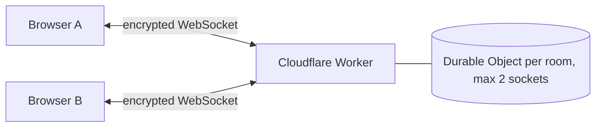

# EphemeralChat — Encrypted Private Chat

**Live: [encrypted-private-chat.vercel.app](https://encrypted-private-chat.vercel.app)**

EphemeralChat is a free, open-source, end-to-end encrypted chat that runs in the browser with no sign-up. It is a privacy-first, real-time 1-to-1 chat app built so conversations stay between peers. Messages are end-to-end encrypted in the browser and relayed through a tiny Cloudflare Worker that only ever sees ciphertext.

There is no database and no message persistence. Because it uses a relay instead of peer-to-peer, it works on any network that can load a website, including corporate Wi-Fi and mobile data. That makes the app a good fit for private, temporary communication where you do not want chats stored, indexed, or replayed later.

## Why this exists

Most chat products optimize for retention, analytics, and long-term storage. EphemeralChat is built for the opposite use case: fast, disposable conversations with minimal surface area and no content history.

## Key features

- End-to-end encrypted (AES-GCM, key in the link's `#fragment`)
- Works on every network, with no STUN/TURN needed
- Zero message persistence, no database
- Max 2 people per room
- One-click room creation and shareable room links
- Minimal UI focused on fast access and clarity
- Built with TypeScript for safer, maintainable code

## Privacy and security model

- Creating a room generates a random 256-bit key and puts it in the link after `#`. Browsers never send the `#fragment` to any server.
- Messages are encrypted with AES-GCM before they leave the browser. The relay forwards ciphertext and stores nothing.
- The relay sees: the room code, when messages are sent, and their approximate size. It never sees the key or the text.
- Anyone who has the full link can join, so share it only with the person you're chatting with. A room holds at most 2 people.

## Tech stack

- Frontend: Next.js 14, React 18, Tailwind CSS 3
- Relay: Cloudflare Workers + Durable Objects (free plan)
- Transport: WebSocket, end-to-end encrypted with WebCrypto

## Repository structure

- `apps/web` - Next.js frontend
- `apps/signaling` - Cloudflare Worker that relays encrypted messages
- `DEPLOYMENT.md` - production deployment guide

## Getting started locally

### Prerequisites

- Node.js 22+
- pnpm 10+

### Install dependencies

```bash
pnpm install
cp .env.example apps/web/.env.local
```

Make sure `apps/web/.env.local` contains:

```env
NEXT_PUBLIC_SIGNALING_URL=ws://localhost:8787
```

### Run the app

Start the signaling server:

```bash
pnpm dev:signaling
```

In a second terminal, start the web app:

```bash
pnpm dev:web
```

Then open the local app, create a room, copy the link, and open it in a second tab to test the full flow.

## Environment variables

| Variable                    | App | Description                                                                                                                     |
| --------------------------- | --- | ------------------------------------------------------------------------------------------------------------------------------- |
| `NEXT_PUBLIC_SIGNALING_URL` | web | WebSocket base URL of the relay worker, such as `ws://localhost:8787` in development or `wss://your-worker.workers.dev` in production |

## Scripts

| Command              | Description                                |
| -------------------- | ------------------------------------------ |
| `pnpm dev:web`       | Start the Next.js dev server               |
| `pnpm dev:signaling` | Start the Wrangler dev server              |
| `pnpm build`         | Build all packages                         |
| `pnpm typecheck`     | Run TypeScript checks across the workspace |
| `pnpm lint`          | Lint all packages                          |
| `pnpm test`          | Run unit tests                             |

## Deployment

See [DEPLOYMENT.md](DEPLOYMENT.md) for the full production deployment guide.

## Architecture



The encryption key stays in the link's `#fragment`, so the relay only handles ciphertext.

## Known limitations

- Messages sent while the other person is offline are not delivered (nothing is stored).
- Chat history is lost on page refresh. Refreshing rejoins the same room.

## License

Apache 2.0
